# Homedy –E-Commerce Website 🛋️
Homedy is a modern sofa e-commerce website developed using Python and Django. The main goal of this project is to provide customers with a simple and user-friendly online shopping experience for purchasing sofas.
This project includes essential e-commerce features such as user authentication, product browsing, category filtering, shopping cart management, checkout, Stripe payment integration, order management, and product reviews.
The website is designed to make online sofa shopping easy, convenient, and secure.

# Project Information
* Project Name: Homedy
* Project Type: Sofa E-Commerce Website
* Backend: Python, Django
* Frontend: HTML, CSS, JavaScript, Bootstrap, HTMX
* Database: SQLite
* Payment Gateway: Stripe
* ORM: Django ORM
* Database File: db.sqlite3

# Features
* User Registration and Login
* Browse and Explore Sofa Collections
* Product Details and Pricing
* Add to Cart and Manage Cart Items
* Secure Checkout Process
* Stripe Payment Integration
* Order Management
* Django Admin Dashboard

# Project Goals
* Build a fully functional sofa e-commerce website.
* Provide a smooth and user-friendly shopping experience.
* Implement secure online payment functionality.
* Manage products, customers, and orders efficiently.
* Develop practical skills in Python, Django, and web development.

# 📸 Website Screenshots
Here are some screenshots of the Homedy E-Commerce Website.

# 🏠 Home Page
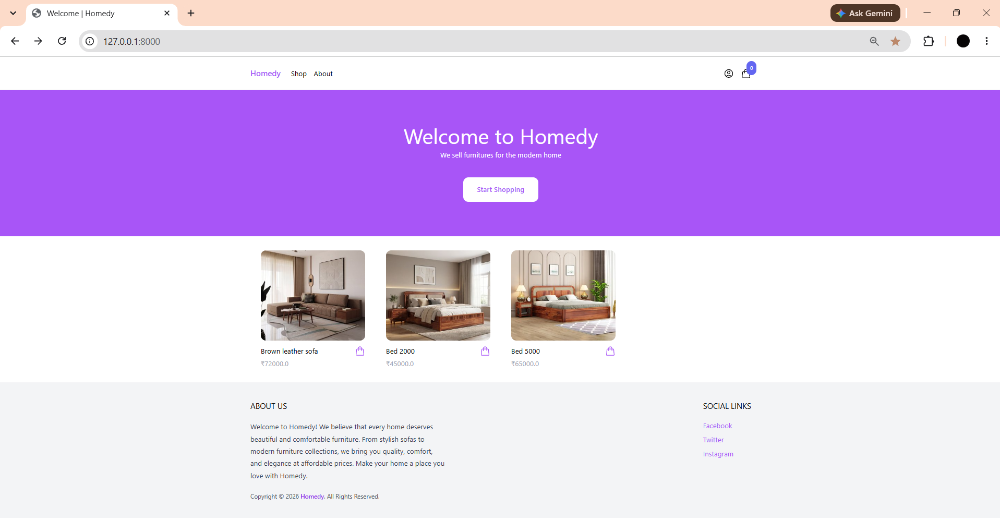

# 👤 User Account
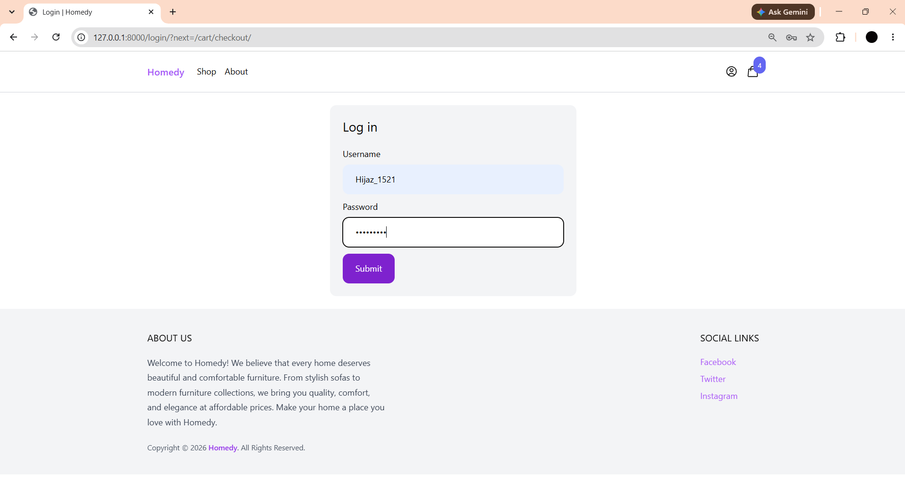

# 🛋️ Product Listing Page
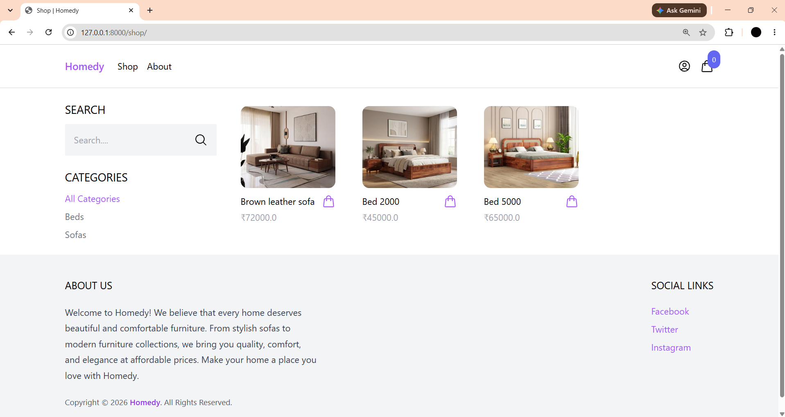

# ⭐ Product Reviews
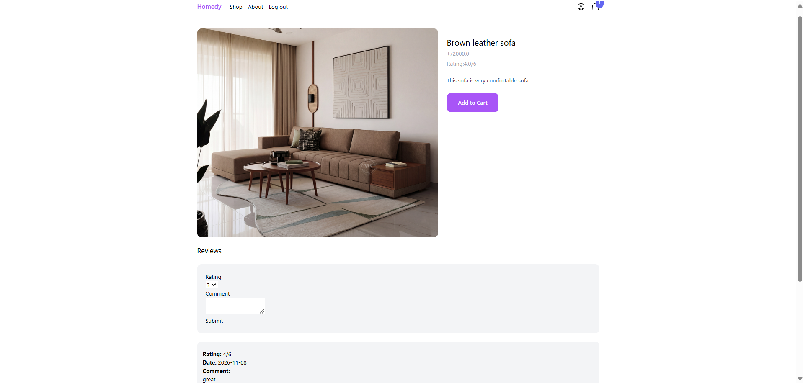

# 🛒 Shopping Cart
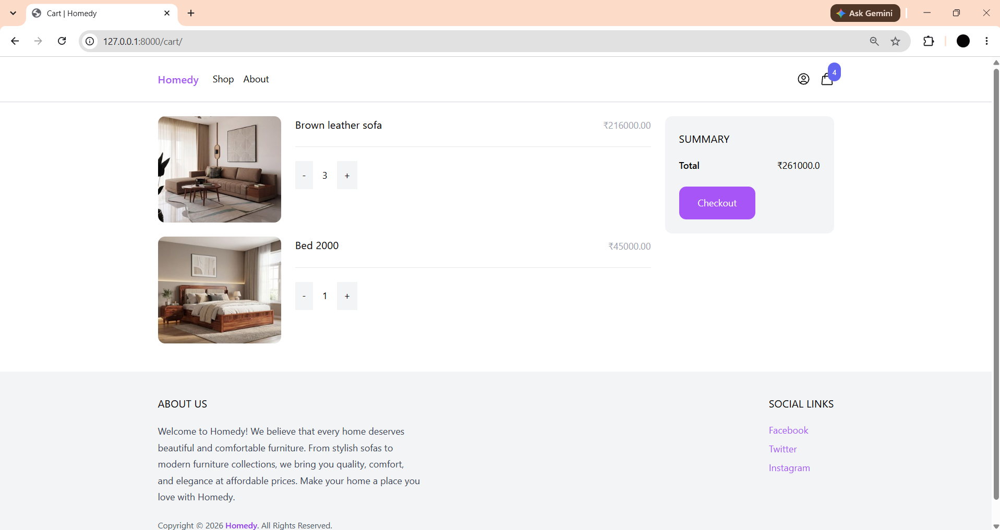

# 💳 Checkout Page
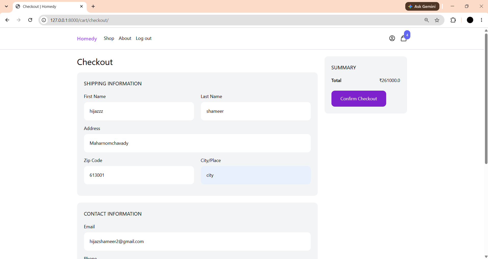

# 💳 Payment Checkout Process Page
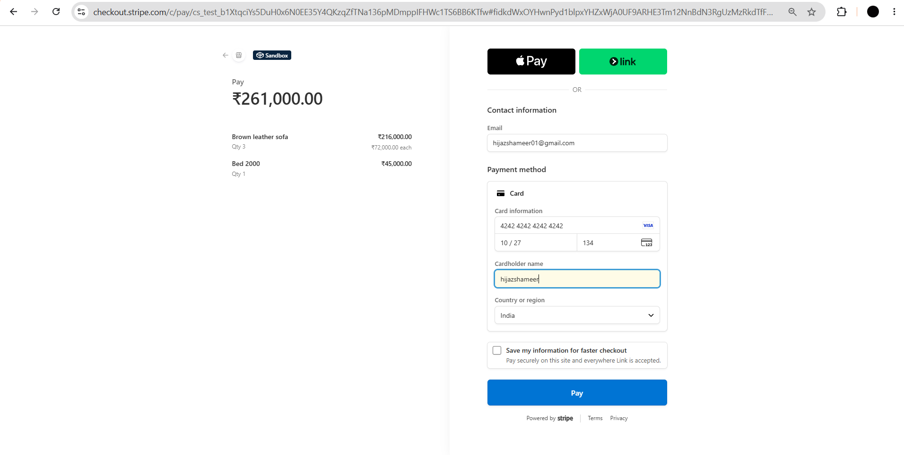

# 🎉 Stripe Payment Transaction Successful
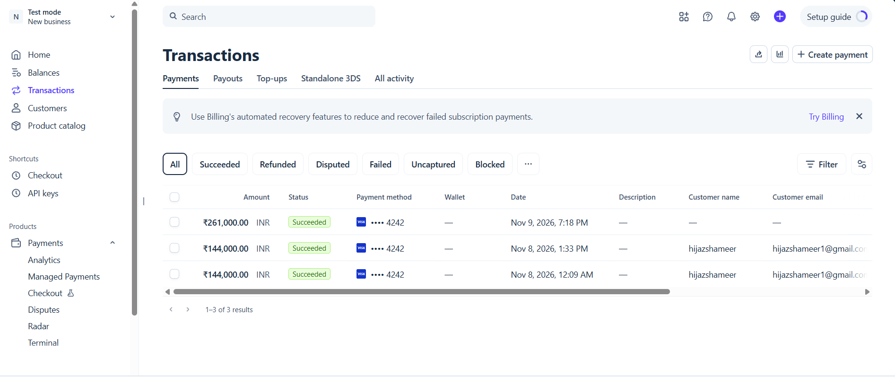

# ✅ Payment Success Page
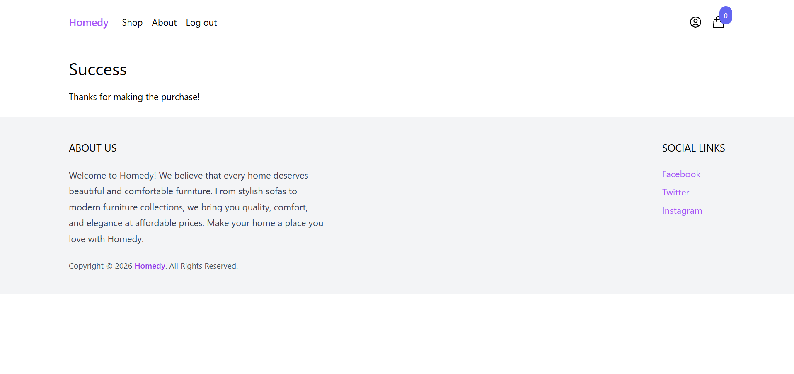

# ⚙️ Django Administration Dashboard
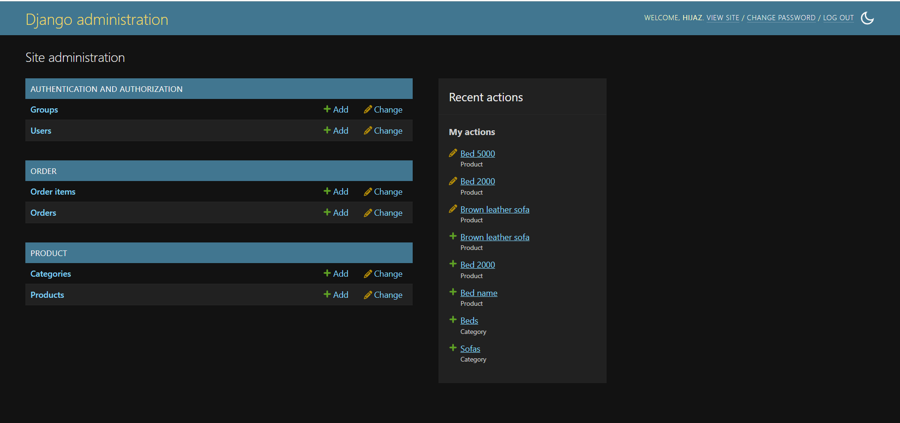
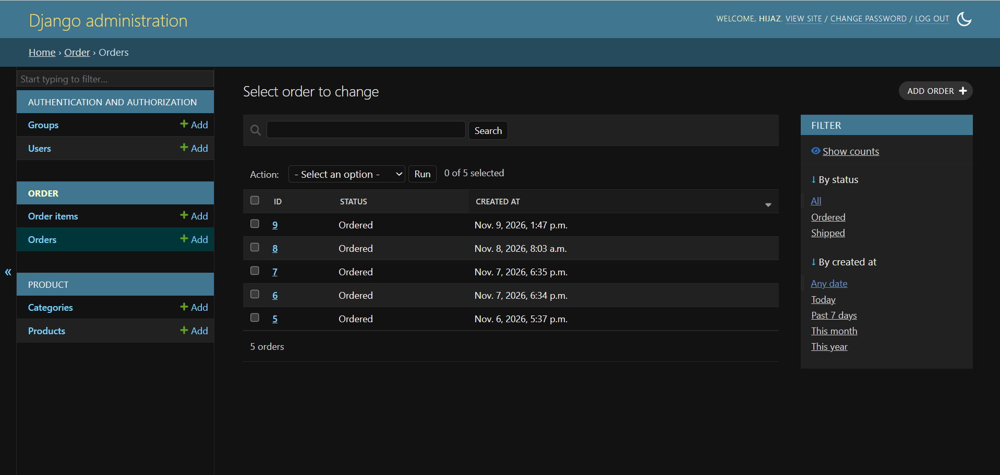
